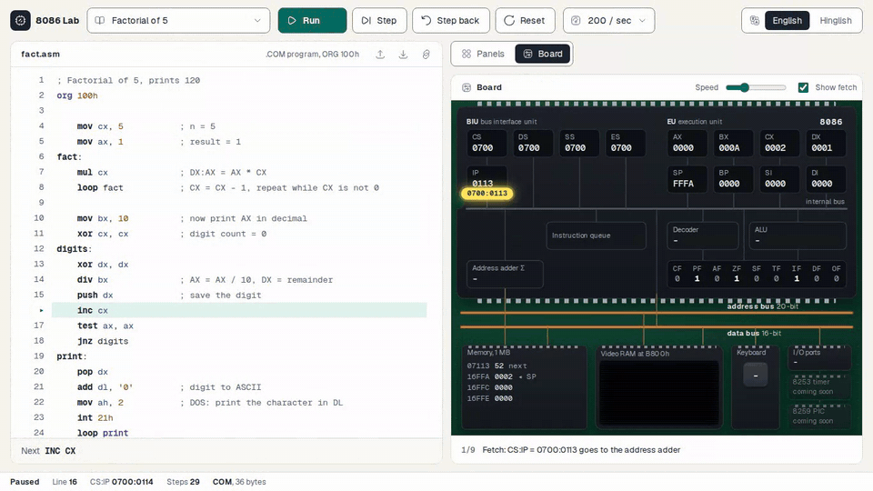

<div align="center">

# 8086 Lab

**Write 8086 assembly, run it, and watch every byte travel across the CPU.**

[](https://8086-emu.pages.dev)
[](#-build-and-run-locally)
[](#-verification)
[](#-how-it-is-built)
[](LICENSE)



</div>

8086 Lab is a browser-based 8086 emulator, assembler and debugger for students who learn the 8086 in engineering labs. It accepts the EMU8086 dialect and classic MASM/TASM programs, runs them on a CPU checked against recordings of a real 8088, and shows each instruction moving through the BIU, EU and system bus. The whole app is one HTML file that works offline.

## 🚀 Try it

Open **https://8086-emu.pages.dev** (also at https://micro-emu.pages.dev), pick an example, press **Run** or **F10** to step.

## ✨ What it does

| Area | What you get |
|---|---|
| Assembler | EMU8086 style (`org 100h`), `.model small` with `.data` / `.code`, and `data segment ... ends` MASM style; `equ`, `dup`, `offset`, `seg`, `byte ptr`, `$`, macros with `local`, `proc far` |
| `emu8086.inc` helpers | `print`, `printn`, `putc`, `gotoxy`, `scan_num`, `print_num`, `print_num_uns`, `print_string`, `clear_screen`, written from scratch (the original file is not copied) |
| CPU | Every documented 8086 instruction, including string ops with `REP`, BCD adjust, far calls and the 8088 quirks the test suite checks |
| DOS and BIOS | INT 21h (01, 02, 06-09, 0A, 0B, 25, 2A, 2C, 30, 35, 4C), INT 10h (teletype, cursor, scroll, char and attribute, write string), INT 16h, INT 1Ah; video memory at B800h with CGA colours |
| Debugger | Run at 2, 10, 20 (default), 200 per second or full speed, step, step back (20,000 steps), breakpoints, registers and flags with "changed" marks, stack, memory and listing views |
| Board view | The 8086 as a circuit board: packets carry real values from CS:IP through the address adder, buses, queue, decoder, ALU and memory, with a caption for every move |
| Teaching help | Assembler errors explain what is wrong, why, and the fix, in English or Hinglish (for example `MUL 5`, two memory operands, `SHL AX, 3`, a jump out of range) |
| Sharing | Copy a link that carries the program, download or open `.asm` files |

<details>
<summary>📚 Built-in examples</summary>

| Example | Shows |
|---|---|
| Hello, world | INT 21h service 09h |
| Factorial of 5 | `MUL`, `LOOP`, printing a number with the stack |
| Sum of an array | `.model small` EXE layout and `@data` |
| Bubble sort | `data segment` / `code segment` MASM style |
| Reverse a string | `PUSH` / `POP` |
| Paint video memory | `STOSW` and `REP STOSW` straight into B800h |
| Uppercase as you type | keyboard input with INT 21h service 08h |
| Add two numbers | `include 'emu8086.inc'` with `scan_num` and `print_num` |

</details>

## 🛠️ Build and run locally

Tested with Node 24 and Bun 1.4.

```bash
bun install
bun run dev          # Vite dev server
bun run build        # writes dist/index.html, one self-contained offline file
```

| Script | Does |
|---|---|
| `bun run check` | Type check, ESLint (strict type-checked, no import cycles) and Vitest |
| `bun run e2e` | Builds, then drives the app in Chromium: every example, step and step back, errors in both languages, board animation, breakpoints, dark mode |
| `bun run xcheck -- --seed 7` | Three-way check of assembler and decoder against GNU objdump (needs binutils) |
| `bun run sst` | Runs all 323 SingleStepTests 8088 files (761 MB downloaded, each deleted after its run); `--files 00.json.gz,F6.6.json.gz` for a subset |

## 🧩 How it is built

React 19, TypeScript, Vite, Tailwind CSS 4, Zustand and TanStack Router and Virtual. The build inlines scripts, styles and fonts into a single HTML file.

| Path | Role |
|---|---|
| `src/emulator/` | CPU (`cpu/`), two-pass assembler (`asm/`), DOS/BIOS layer and step-back history (`machine/`), disassembler. Plain TypeScript, no React |
| `src/session/` | Zustand stores: the running session (program, run loop, breakpoints, keys) and persisted preferences |
| `src/features/` | `editor`, `registers`, `inspector` (stack, memory, listing), `screen`, `board` (geometry, plan builder, animator), `toolbar`, `status`, `share` |
| `src/i18n/` | Error and notice text in English and Hinglish, typed so every code has both |
| `src/ui/` | Button, segmented control, select, panel, `cn` |
| `src/examples/` | The example programs as `.asm` files |
| `scripts/` | SingleStepTests runner, objdump cross-check, browser flows |

The URL keeps the view and the example (`?view=board&example=sort`), so a board view can be linked directly.

## ✅ Verification

| Check | Result |
|---|---|
| SingleStepTests 8088 v2, all 323 opcode files, 3,007,000 tests | 2,981,951 pass; the other 25,049 are DIV/IDIV/AAM divide errors where only the undefined flag bits pushed on the stack differ; registers, IP, flags and all other memory match |
| Assembler and decoder vs GNU objdump, 4 random corpora | 4,515 of 4,515 instructions agree three ways (source, decoder, objdump) |
| Vitest | 169 tests: encodings and error codes, DOS/BIOS services, COM/EXE layout, step back and replay for every example, board plan vs real CPU state for every executed instruction |
| Browser flows (`bun run e2e`) | 8 of 8 examples produce the expected screen output; no page overflow at 1366 x 768; no JS errors |

## ⚠️ Limits

- The board shows fetch and execute one after the other; the real 8086 overlaps them with its prefetch queue.
- 8255, 8253 and 8259 are placeholders on the board; there are no virtual LEDs, displays or motors yet.
- Board captions are English only; the Hinglish toggle covers error messages.
- `REP` string instructions are drawn as one iteration, with the count in the caption.

## 🙏 Credits

- CPU checked against [SingleStepTests/8088](https://github.com/SingleStepTests/8088) (MIT), a test suite generated from a real 8088.
- Icons from [Hugeicons](https://hugeicons.com) free set (MIT); fonts [Geist and Geist Mono](https://github.com/vercel/geist-font) (SIL OFL 1.1, licence in `src/assets/fonts/OFL.txt`).
- Inspired by EMU8086; no code, text or assets from it are used.

## 📄 License

[MIT](LICENSE). Bundled fonts keep their own SIL OFL 1.1 licence.
